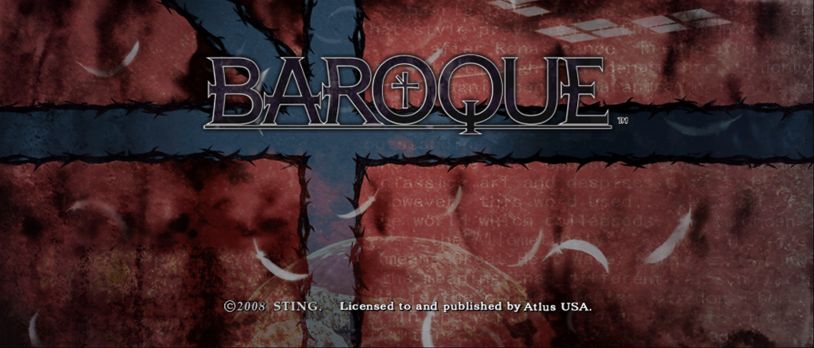
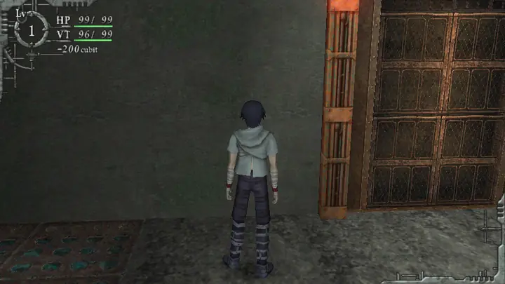
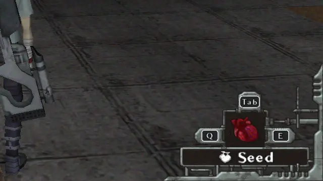
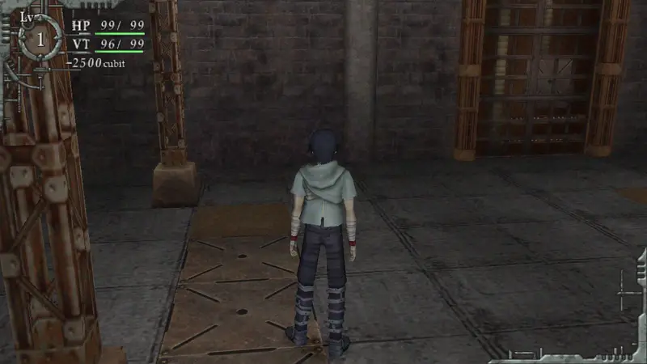
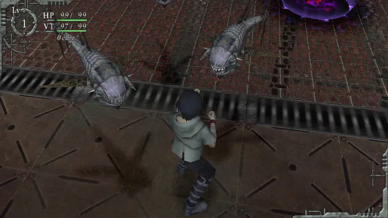
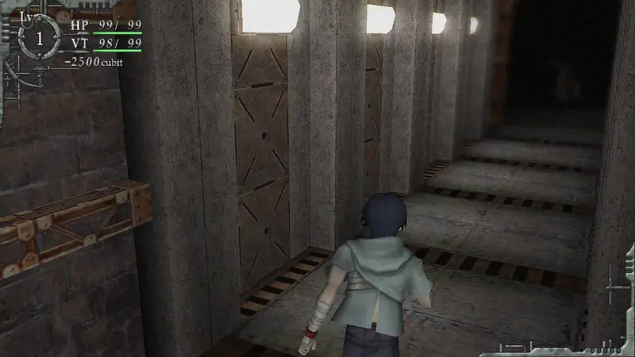
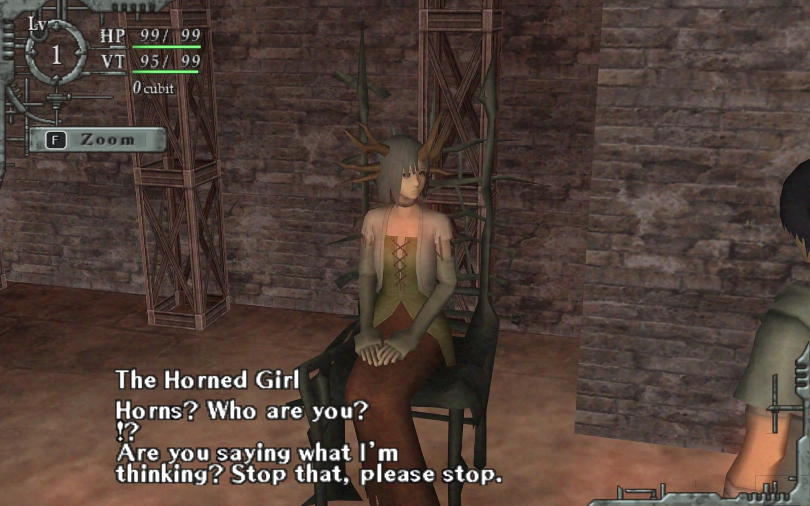
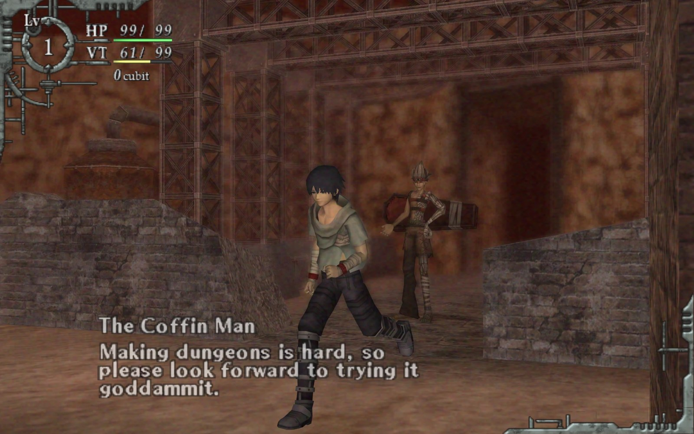
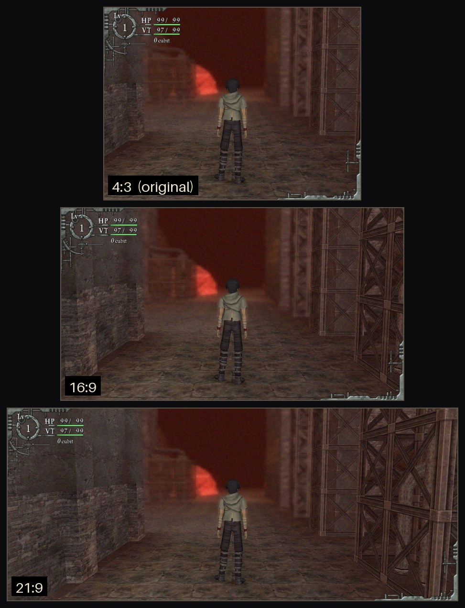

# Baroque — native PC port

An unofficial native Windows port of **Baroque** (PlayStation 2, Sting / Atlus, 2008), translated function by function from the original game code. It is not an emulator: the game runs as a normal Windows program.

**No game data is included.** You need your own copy of Baroque (USA). The game copies what it needs from your disc image the first time it starts.

This is an AI-assisted decompilation, made with Claude Opus 5.5.



### Features

- Widescreen 16:9 and 21:9
- 60 / 120 / 144 / unlimited fps (game logic stays at 30)
- Free mouse camera, rebindable keys, mouse menus
- Button prompts switch between keyboard and controller
- PC Settings in the game, borderless fullscreen

| Mouse camera | Button prompts |
| --- | --- |
|  |  |
| **PC Settings** | |
|  | |

### In-game screenshots

|  |  |
| --- | --- |
|  |  |

<details>
<summary>Aspect ratios: 4:3 (original), 16:9, 21:9</summary>



</details>

## Playing

1. Download the latest zip from [Releases](../../releases) and unzip it into a normal folder (not *Program Files*).
2. Make an `.iso` of your **Baroque (USA)** disc (SLUS-21714) and put it next to `Baroque.exe`.
3. Start `Baroque.exe`. The first start copies the game data out of the image (about 2.5 GB, once). After that you can delete the `.iso`.

No decompiling, no extra tools: unzip, add your disc image, play.

### Voices

- The USA disc gives you the **English** voices.
- For the **Japanese** voices, also put your **Baroque (Japan)** `.iso` (SLPM-66747) next to `Baroque.exe` and start the game again. Then pick *PC Settings → Voices → Japanese*. The text stays English, and the cut-scenes use the Japanese timing so lines aren't cut off.
- Got an undubbed USA image? It works too: it starts with Japanese voices, and a Baroque (Europe) `.iso` adds the English ones.

## What the port adds

All optional, in **PC Settings** (title screen → Option, or in game: item screen → Game Config):

- **Widescreen**: 16:9 and 21:9 (or the original 4:3), with the HUD at the screen edges or in its original place.
- **Frame rate**: 60 / 120 / 144 / unlimited / VSync, with smooth in-between frames. The game itself still runs at its original 30 ticks per second.
- **Keyboard and mouse**: a free mouse camera, rebindable keys and mouse buttons, and optional aim assist for mouse attacks.
- **Button prompts follow your input.** Use the keyboard and every on-screen button shows your key. Touch the controller and the original PS2 buttons come back right away.
- **Mouse menus**: hover and click in the menus.
- **Window**: windowed or borderless fullscreen (Alt+Enter), pause and mute while the game is in the background.
- **Saves** are files next to the game, not a memory card.

A controller works just like on the PS2. The mouse camera turns itself off while you play with a controller.

## Building from source

Requirements: Windows 10/11, Visual Studio 2022 (C++), CMake 3.20 or newer, and a prebuilt **FFmpeg 7.x shared LGPL** build for Windows (used for the cut-scene movies). raylib 5.5 is downloaded automatically.

```bash
cmake -S native -B build/release -G "Visual Studio 17 2022" -A x64 -DBAROQUE_FFMPEG_ROOT=C:/path/to/ffmpeg-7.1-win64-lgpl-shared
```

```bash
cmake --build build/release --config Release --target Baroque-Native
```

The game is `build/release/Release/Baroque.exe`. Put your USA `.iso` next to it and start it, as above. `tools/package_release.ps1` builds the release zip.

Optional, made from your own extracted data: the window icon (`python tools/make_icon.py`).

## Repository layout

| Folder | Contents |
| --- | --- |
| `native/` | The port (C++20). `CONVENTIONS.md` and `DESIGN.md` explain how the original code is translated. |
| `native/alchemy/` | Intrinsic Alchemy (IGB) model loader, renderer and Enbaya animation |
| `native/game/` | Game logic: player, enemies, items, dungeon generation, events, menus, HUD |
| `native/audio/`, `native/video/` | Sound system (IOP / SPU model) and PSS movie playback |
| `native/platform/` | Windows host: window, input, first-start setup from your disc image |
| `tools/` | Python tools for the game's file formats, used during development |

## Legal

Baroque is © Sting / Atlus. This is an unofficial fan project, not affiliated with or endorsed by the rights holders. It contains no game assets, text, audio or video. Everything is read from your own disc image at run time. The code is a re-implementation written from analysis of the original program. Please buy and dump your own copy.

Third-party components: raylib (zlib license) and FFmpeg (LGPL, dynamically linked). See `tools/package/THIRD_PARTY_NOTICES.txt`.
